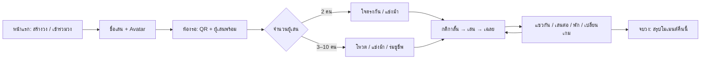

# Story Circle — แผนทำให้เล่นกับเพื่อน 2–10 คนที่ร้านได้สนุกและต่อเนื่อง

วันที่วิเคราะห์: 16 ตุลาคม 2026 
ฐานโค้ด: `codex/optimize-railway` ที่ commit `353891a` 
เว็บที่ตรวจ: https://striking-sparkle-production-adf7.up.railway.app 
สถานะเอกสาร: ผลวิเคราะห์และข้อเสนอสำหรับพัฒนาต่อ ยังไม่ได้ติดตั้งการเปลี่ยนแปลงในเอกสารนี้

## 1. ข้อสรุปและทิศทางผลิตภัณฑ์

**ควรทำให้ Story Circle เป็นตัวช่วยสร้างโมเมนต์ให้เพื่อนในโต๊ะ: เปิดวงง่าย เล่นรอบสั้น แล้วเงยหน้ามาคุยและแซวกันได้** เป้าหมายหลักคือเพื่อน 2–10 คน ใช้มือถือคนละเครื่อง ไม่ต้องมีจอทีวีหรือคนคุมเกมตลอดเวลา

ฐานเดิมมีสิ่งที่ควรเก็บ: ชื่อม้าและบุคลิกชวนเชียร์, เกมโหวตที่สร้างบทสนทนา, เกมวัดใจที่กดครั้งเดียว, QR เข้าห้อง และระบบ realtime ที่เริ่มใช้งานได้แล้ว แต่ยังมีช่องว่างเรื่องกลับเข้าเกมหลังหลุด กติกากับคะแนนไม่ตรงกัน และขั้นตอนที่ให้เจ้าห้องจัดการมากเกินไป จึงยังไม่ควรเรียกว่าเวอร์ชันพร้อมเล่นยาวในร้านโดยไม่มีคนช่วยแก้ปัญหา

ลำดับลงทุนที่แนะนำคือ **เกมไม่พังกลางวง → เข้าเล่นง่าย → กติกาและจังหวะสนุก → ภาพและความลื่น → ขยายจำนวนวง** ยังไม่ควรเพิ่มเกมใหม่ก่อนสามเกมเดิมเล่นต่อเนื่องได้

ข้อกำหนดหลัก:

- เจ้าห้องสร้างวงแบบชื่อเล่นได้ เพื่อนสแกน QR หรือกรอกรหัสแล้วเข้าได้โดยไม่ต้องสมัครสมาชิก
- 2 คนเห็นโหมดที่รองรับจริง: แข่งม้าและใจตรงกัน; 3–10 คนเพิ่มโหวตข้างน้อยและร่มชูชีพ
- อ่านกติกาหลักได้ในหนึ่งประโยค มีตัวอย่างสั้นครั้งแรก และเห็นว่า “ตอนนี้ต้องทำอะไร” เสมอ
- เล่นได้โดยปิดเสียง เพราะร้านอาจเสียงดัง; สี ข้อความ และการเคลื่อนไหวต้องบอกสถานะครบ
- สลับไปตอบแชต ล็อกจอ หรือเน็ตหลุดแล้วกลับมาที่รอบเดิมได้
- มี “พักวง / ข้ามรอบ / เล่นต่อ / จบวง” ที่ไม่ทำคะแนนเพี้ยนและไม่บังคับให้ทุกคนพร้อมตลอดเวลา
- ความสนุกใช้การลุ้น คุย และแซวกัน; บทลงโทษเลือกเป็นแต้มเสียหรือกิจกรรมขำ ๆ และข้ามได้ ไม่ใช้ข้อความบังคับดื่มเต็มแก้วเป็นค่าเริ่มต้น

## 2. ตรวจอะไรแล้ว และยังไม่ทราบอะไร

ตรวจเส้นทางหน้าแรก เข้าห้อง ห้องรอ ทั้งสามเกม ระบบ auth/socket, handlers, schema, stats, AI และ deployment configuration จากโค้ด ดูหน้าแรกจริงที่ viewport 390×844 และยืนยันว่าหน้าแรกมีเพียงเข้าสู่ระบบ/สมัครสมาชิกเป็นทางเข้าหลัก ปุ่มสองปุ่มนี้มีความสูงมากกว่า 44 CSS px อยู่แล้ว จึงไม่เหมารวมว่าปุ่มทุกจุดเล็กเกินไป

การทดสอบก่อนหน้ามีสาม socket clients เล่นครบสามเกมและ reconnect แบบสั่งเข้าห้องอีกครั้ง ผ่านแล้ว ตาม `DEPLOYMENT.md` แต่ยังไม่ใช่หลักฐานว่าหน้าเว็บจะกู้สถานะเองเมื่อผู้ใช้ refresh หรือสลับแอป และไม่ใช่การทดสอบความสนุกกับคนจริง

รอบวิเคราะห์นี้จำลองแข่งม้า 1,000 ครั้งบนเครื่อง โดยใช้ชื่อม้าจริงและสุ่ม speed/stamina/luck ช่วง 70–90 เหมือน production พบเวลาภาพเคลื่อนไหวตาม protocol ปัจจุบันประมาณ **ต่ำสุด 19.2 / มัธยฐาน 22.4 / p95 24.2 / สูงสุด 25.4 วินาที** ไม่รวมการเลือกม้า 30 วินาทีหรืออ่านผล ตัวเลขเป็นตัวอย่างสุ่มหนึ่งชุด ไม่ใช่ผลวัดมือถือหรือเครือข่ายจริง

การจัดประเภทข้อค้นพบในเอกสาร:

- **ยืนยันจากโค้ด/หน้าเว็บ:** พฤติกรรมหรือค่าที่เห็นโดยตรง
- **ความเสี่ยงจากโค้ด:** มีเส้นทางทำให้ผิดได้ ต้องเพิ่มการทดสอบเพื่อยืนยันกรณีแข่งขันกันหรือหลุดเชื่อมต่อ ไม่ได้โจมตี production เพื่อพิสูจน์
- **ข้อเสนอ:** ต้องทดลองกับคนจริงก่อนสรุปว่าสนุกกว่าเดิม

ยังไม่ได้ทดสอบมือถือจริง 10 เครื่องพร้อมกัน, Safari เมื่อพักจอ, Wi-Fi ร้านที่มี captive portal, load ต่อเนื่องหลายวง, ค่าใช้จ่ายรายเดือน หรือการสำรองและกู้ฐานข้อมูลจริง

## 3. ประเด็นที่ต้องแก้ก่อนนำไปเล่นจริงจัง

| ลำดับ | สิ่งที่พบและหลักฐาน | ผลต่อวง | สิ่งที่ต้องทำ |
|---|---|---|---|
| P0 | หน้าเกม HorseRace เข้าหน้าแล้ว host ที่ไม่มี local raceId สั่ง `horse:newRace`; PanicJump ทำคล้ายกัน [S1,S2] | refresh ของเจ้าห้องมีเส้นทางสร้างเกมใหม่/รีเซ็ตคะแนน แทนการกลับรอบเดิม | แยก “เปิดหน้า” ออกจาก “สร้างรอบ”; ขอ snapshot ปัจจุบันก่อนเสมอ |
| P0 | socket connect เปลี่ยนเพียง connected; ไม่มีการ resume ห้องและ snapshot กลาง [S3] | reconnect สำเร็จแต่ผู้เล่นอาจไม่เห็นรอบที่กำลังเล่น | resume ทุกครั้งที่ connect และเมื่อกลับหน้าเว็บ; รับ version จาก server |
| P0 | ตัวจับเวลาแข่งม้าและโหวตอยู่บน browser; host เป็นคนส่งเริ่ม/เฉลยตอนหมดเวลา [S1,S4] | เจ้าห้องพักจอแล้ววงอาจค้างหรือเวลาคลาดกัน | server เก็บ startedAt/deadline และเปลี่ยน phase เอง |
| P0 | vote ตรวจสถานะแล้วเพิ่มสถิติ ก่อนเปลี่ยนสถานะ; horse เริ่มแข่งตรวจ/เขียนคนละขั้น; jump reveal เปลี่ยนสถานะนอก transaction คะแนน [S5,S6,S7] | คำสั่งพร้อมกันอาจคิดซ้ำ หรือ crash แล้วผลไม่ครบ | เปลี่ยนสถานะแบบมีเงื่อนไขใน transaction เดียวกับผลและคะแนน; idempotency |
| P0 | บาง game handlers ไม่มี host/member/round-room checks เช่น horse:newRace, vote:reveal, jump:start/action/nextRound [S5,S6,S7] | ผู้เล่นผิดคนหรือคำสั่งเก่าอาจรีเซ็ต/ข้ามรอบ | ตรวจผู้ส่ง ห้อง รอบ phase และสิทธิ์ทุก mutation ฝั่ง server |
| P0 | leave และ disconnect cleanup ไม่มีขั้นตอนย้าย host [S8] | ปุ่มสำคัญเหลืออยู่กับคนที่ไม่อยู่แล้ว | โอนเจ้าห้องเมื่อออก; เมื่อหลุดให้ grace period แล้วเลือกคนออนไลน์ใน transaction |
| P0 | jump เก็บ survivors จาก row เก่าก่อนเขียน points แล้วส่ง s.points; เริ่มเกม reset RoomPlayer.score [S7] | คะแนนรอบที่แสดงอาจเป็น 0 ทั้งที่ leaderboard เพิ่ม และคะแนนม้าเดิมหาย | สร้าง result จากค่าคำนวณจริง; แยกคะแนนแต่ละเกม/แต่ละ session |
| P1 | หน้าแรกเน้น account; JoinRoom สร้าง guest ก่อนรู้ว่าห้องใช้ได้หรือไม่ [S9] | มือใหม่เสียเวลา และเกิด guest เกินจำเป็น | สร้าง/เข้าวงด้วยชื่อเล่น; preview ห้องและเข้าร่วมแบบ atomic |
| P1 | registry มีสองเกมและโหวต min3 แต่หน้า Room มีสามเกมและโหวต min2; lobby ปรับขนาด3–30 [S10] | ข้อมูลไม่ตรงเป้าหมาย2–10และแต่ละหน้า | shared game manifest พร้อมโหมด2คน; server เป็นผู้ยืนยันข้อจำกัด |
| P1 | คำถามสำรองมี12ข้อ แบ่ง6หมวด; ไม่มีการกันซ้ำในวง [S5] | เล่นไม่กี่รอบก็จำคำถามได้ โดยเฉพาะเลือกหมวดเดิม | curated deck, questionId, shuffle ไม่ซ้ำ และปุ่มสุ่มใหม่ |
| P1 | jump รอแสดงผล 4,000 + 800×ผู้เล่น ms [S2] | 10 คนรอเอฟเฟกต์12วินาทีหลังรอบกด8วินาที | เฉลยพร้อมกันภายใน3–4วินาทีและกดข้ามได้ |
| P1 | auth/me ล้มเหลวทุกแบบแล้วลบ token [S11] | เน็ตสะดุดกลายเป็นหลุดบัญชี/ชื่อเดิม | แยก401ออกจาก network/5xx; แสดง retry และเก็บ session เดิม |
| P1 | QR ใช้รูปจากบริการภายนอก; meta viewport ปิด zoom [S12] | เข้าห้องพึ่งอีกโดเมน และอ่านข้อความยากแล้วขยายไม่ได้ | QR สร้างในเครื่อง, copy/share link สำรอง, เปิด pinch zoom |
| P2 | global stats รวม drinkStats แต่ empty-room cleanup ลบห้องและ cascade สถิติ [S8,S13] | “สะสมตลอด” ไม่ได้อยู่ถาวรตามความคาดหวัง | ให้ผลคืนนี้เป็นหลัก; กำหนด retention/summary ให้ชัดก่อนทำสถิติระยะยาว |

## 4. ประสบการณ์ที่ควรได้ตั้งแต่เปิดเว็บถึงจบวง

**หน้าแรก:** ประโยค “เกมสั้น ๆ สำหรับเพื่อนทั้งโต๊ะ” ตามด้วยปุ่มหลัก “สร้างวง” และ “เข้าร่วมวง” ช่องรหัสเข้าถึงง่าย สมัครสมาชิกเป็นทางเลือกสำหรับเก็บประวัติภายหลัง ไม่วางเป็นเงื่อนไขก่อนเล่น

**เข้าวง:** เปิดลิงก์แล้วเห็นชื่อวง เกมที่จะเล่น จำนวนคน และสถานะก่อนตั้งชื่อ จำ avatar เดิมได้ ผู้มีบัญชีใช้ตัวตนเดิมได้ ไม่สร้าง guest ทับบัญชีโดยอัตโนมัติ ชื่อซ้ำแยกด้วย avatar/ป้ายสั้น ไม่โชว์รหัสภายใน `#...` ตลอดทุกหน้า ห้องเต็ม/หมดอายุมีปุ่มกลับหรือใส่รหัสใหม่

**ห้องรอ:** แสดง QR ใหญ่ รหัส6ตัว ปุ่มแชร์/คัดลอก และผู้เล่นที่ออนไลน์/พร้อม ค่าเริ่มต้นความจุ10 ไม่ให้เจ้าห้องต้องปรับ slider จำนวนมาก ผู้เล่น2คนเห็นคำแนะนำโหมดที่เล่นได้ เมื่อคนเพิ่มระหว่างเกมให้รอรอบถัดไปและเห็นเวลารอ ไม่แทรกกลางรอบ

**เริ่มเล่น:** แนะนำ “เล่นผสม 6 รอบ” เป็นทางเลือก ประมาณ8–12นาทีรวมคุย เป็นสมมติฐานสำหรับ playtest; เจ้าห้องเลือกเกมเองได้ โหมดแนะนำของ3–10คนคือโหวต2 → ม้า1 → ร่มชูชีพ3 สำหรับ2คนคือใจตรงกัน4 → ม้า2 ไม่เปลี่ยนเกมอัตโนมัติขณะยังอ่านผล

**ระหว่างเกม:** หนึ่งหน้ามีคำสั่งหลักหนึ่งอย่าง เช่น “เลือกข้าง” หรือ “กระโดด” แสดง “ส่งแล้ว 6/8 คน” ด้วยข้อมูลที่ server ยืนยัน มีป้ายกำลังเชื่อมต่อที่มองเห็นได้ และไม่แสดงว่าส่งสำเร็จเมื่อยังไม่ได้รับ ack

**หลังเฉลย:** แสดงสิ่งที่เกิดขึ้นและเหตุผลให้เข้าใจทันที ไม่ซ่อนผลสำคัญไว้หลัง overlay มีปุ่ม “พร้อมรอบต่อไป” และ host “ไปต่อ” แสดงเวลาคุยแบบไม่บังคับนับถอยหลัง; overlayฉลองอาจหายเองได้แต่ผลต้องยังอ่านได้

**พักและจบวง:** คำสั่งพักระหว่างรอบเป็นหลัก ส่วนรอบจับเวลาที่เริ่มแล้วให้จบตามกติกาหรือยกเลิกทั้งรอบโดยไม่คิดผล ไม่หยุดนาฬิกาของบางคนกลางเกม จบวงเห็นแต้มรายเกมและโมเมนต์ เช่น “ใจตรงกัน3ครั้งติด”, “เชียร์ม้าติดTop3มากที่สุด” แชร์ภาพสรุปได้ด้วยการกดเอง

## 5. ปรับทั้งสามเกมอย่างไร

### แข่งม้า — เกมเชียร์ของทั้งโต๊ะ

**ปัจจุบัน:** เลือก1ใน8ม้า มีโพย3กูรู เลือกได้30วินาที เจ้าห้องเริ่มได้ก่อนเวลา อันดับ1–3รอด อันดับ4–8เสียผลลัพธ์ และให้คะแนนอันดับ1=8 ถึงอันดับ8=1 มีความเป็นเกมเชียร์อยู่แล้ว ควรเก็บชื่อม้า/บุคลิก/การแซงไว้

**ปัญหาจังหวะ:** ตัวอย่างจำลองมีภาพแข่งมัธยฐาน22.4วินาที เมื่อบวกเลือก30วินาทีจะเกิน52วินาทีก่อนผล หากเล่นซ้ำคนอาจรอนาน เป้าหมายใหม่ควรทดลองเลือก15–20วินาทีและภาพแข่ง12–15วินาที โดยเปลี่ยนอัตราเล่น timeline อย่างสม่ำเสมอ ไม่บิดผลกลางแข่ง

**การปรับที่เสนอ:**

1. ขึ้นกติกา “เลือกม้า1ตัว — ติด3อันดับแรกรอด” ก่อนเริ่ม หน้าทุกแห่งต้องไม่เขียนว่าเลือกผิดผู้ชนะแล้วแพ้ทั้งหมด
2. เก็บ8ม้า แต่ลดข้อมูลบนการ์ดเป็นชื่อ รูป และประโยคบุคลิก; โพยกูรูเปิดเพิ่มได้ แสดงม้าที่เราเลือกชัดที่สุดในสนาม
3. ใช้ server deadline; เมื่อทุกคนเลือกแล้วเปิดช่วงยืนยันสั้น3วินาทีก่อนปิดรับ ไม่ให้ host เริ่มทันทีจนคนสุดท้ายไม่มีโอกาสเลือก
4. แสดง “เลือกแล้ว” เมื่อ server รับจริง; เปลี่ยนม้าได้ก่อน deadline ถ้าหมดเวลาแล้วยังไม่เลือกให้เป็นผู้ชมรอบนั้น ไม่คิดแพ้เพราะการส่งล้มเหลว
5. ใส่ชื่อเพื่อน/จำนวนคนเชียร์บนม้าและเน้นจังหวะแซง 1–2ครั้ง ปิดเสียงก็เข้าใจ ไม่ต้องอ่านตารางซ้อนระหว่างแข่ง
6. ผลแสดงม้าของเรา อันดับ เหตุผลรอด/แพ้ และคะแนนที่ได้ หน่วย finishTick ต้องแปลงเป็นเวลาตาม timeline จริง หรือเอาหน่วยเวลาออก ไม่ใส่ tick แล้วเรียกวินาที
7. รอบใหม่และเดิมพันต้องไม่ซ้ำจาก double tap; ล็อกการเลือกก่อนส่ง timeline ที่บอกอนาคตของการแข่งขันให้ client

**ผ่านเมื่อ:** 2และ10คนเลือกพร้อมกันแล้วมีตัวเลือกสุดท้ายคนละ1รายการ ผลตรงกันทุกเครื่อง รีเฟรชระหว่างแข่งกลับมาที่ตำแหน่งตามเวลาปัจจุบันได้ ไม่เล่นภาพจากต้น และไม่เสียคะแนนเมื่อไม่มีเดิมพัน

### โหวตข้างน้อย / ใจตรงกัน — เกมเปิดบทสนทนา

**ปัจจุบัน:** คนตั้งคำถามหมุนเวียน พิมพ์คำถามและสองตัวเลือก หรือกด AI; เลือกภายใน20วินาที; 3คนขึ้นไปฝ่ายน้อยแพ้ เสมอแพ้ทุกผู้โหวต; 2คนระบบเปลี่ยนเป็นใจตรงกัน โหวตเหมือนกันรอดทั้งคู่ โหวตต่างกันแพ้ทั้งคู่

**ข้อสังเกต:** คำว่า “เสียงส่วนน้อย” อาจทำให้เข้าใจว่าต้องเลือกฝั่งน้อยเพื่อชนะ ควรใช้ชื่อพร้อมบอกเงื่อนไขชัด การให้พิมพ์ทุกตาเพิ่มภาระและทำให้วงรอคนคิด ส่วน2คนควรเป็นเกมความเข้ากัน ไม่ใช้ตารางแข่งกันที่ทั้งคู่ได้ผลเท่ากันเสมอ

**การปรับที่เสนอ:**

1. แยกป้ายโหมดชัด: “โหวตข้างน้อย — อย่าอยู่ฝั่งน้อย” สำหรับ3–10 และ “ใจตรงกัน — เลือกให้ตรงกัน” สำหรับ2คน ล็อกโหมดและรายชื่อผู้เข้าร่วมตั้งแต่ต้นรอบ ไม่เปลี่ยนกติกาเพราะคนเข้า/ออกขณะโหวต
2. ค่าเริ่มต้นหยิบคำถามพร้อมเล่น ให้เจ้าของตาแค่เลือก “ใช้ข้อนี้ / สุ่มใหม่ / เขียนเอง” ใช้คำว่า “สุ่มคำถาม” เมื่อใช้คลังสำรอง ไม่แสดงว่า AI สร้างสดถ้าไม่ได้เรียก AI
3. ทำคลังเริ่มต้น120ข้อ แบ่ง4ชุด: เริ่มวง30, เรื่องเพื่อน30, สมมติกวน ๆ30, ใจตรงกัน30 มี questionId, mode, category, intensity และ seenQuestionIds ของวง กันซ้ำก่อนหมดชุด
4. โหวต3–10คนให้เวลาอ่าน/แซว5วินาที แล้วเลือก15วินาที ทดลองไม่โชว์สัดส่วนA/Bก่อนปิดรับ ผู้เล่นแก้ตัวเลือกได้จน deadline โดยให้ server ยืนยันตัวเลือกสุดท้าย
5. ใจตรงกัน2คนให้เลือกเงียบ ๆ แล้วเฉลยพร้อมกัน นับ streak เช่น “ตรงกัน3/5ข้อ” คนหนึ่งไม่ส่งให้รอบนั้นเป็นไม่ครบ/ข้าม ไม่ตีความว่าใจไม่ตรงกัน
6. เสมอใน3–10คนแนะนำค่าเริ่มต้น “เสมอ รอดทั้งวง” พร้อมประโยคชวนคุย แทนผลแพ้ทุกคนบ่อยในวงจำนวนคู่ หากจะมีโหมดเดิมให้เลือกก่อนเริ่มและอธิบายชัด
7. หลังเฉลยมีคำชวนคุยหนึ่งบรรทัด เช่น “ฝั่งน้อยมีเหตุผลอะไร?” ไม่สร้างคำถามบังคับเปิดเผยเรื่องส่วนตัว; ผู้เล่นข้ามคำถามได้

ตัวอย่างทิศทางเนื้อหา (ข้อเสนอ ยังไม่ใช่คลังที่นำเข้าระบบ):

| ชุด | คำถาม | A | B |
|---|---|---|---|
| เริ่มวง | ถ้าร้านเปิดได้อีกแค่เพลงเดียว อยากได้แบบไหน? | ร้องตามทั้งโต๊ะ | ลุกเต้นทั้งโต๊ะ |
| เรื่องเพื่อน | นัดเที่ยวพรุ่งนี้เช้า คนในวงจะพลาดเรื่องไหนก่อน? | ตื่นสาย | ไปผิดจุดนัด |
| สมมติกวน ๆ | เลือกพลังสำหรับคืนนี้หนึ่งอย่าง | จำชื่อทุกคนได้ | เลือกเพลงถูกใจทั้งร้าน |
| ใจตรงกัน | ทริปคู่หูแบบไหนน่าจะรอดกว่า? | วางแผนครบ | ไปก่อนค่อยคิด |

**ผ่านเมื่อ:** เลือกหมวดเดิม10ตาไม่ซ้ำ, ไม่มี API key ก็เล่นได้ครบ, คำถามอ่านเข้าใจโดยไม่ต้องมีคนอธิบายซ้ำใน playtest, กดโหวต/เฉลยซ้ำไม่เพิ่มผลมากกว่าหนึ่งครั้ง และ2คนมีผลกรณีส่งไม่ครบอย่างถูกต้อง

### ร่มชูชีพวัดใจ — เกมลุ้นสั้นที่ต้องกติกาชัด

**ปัจจุบัน:** ขั้นต่ำ3คน มี8วินาที คนแรกแพ้ คนลำดับ2ถึงquota+1รอดหากทันเวลา โควต้าสุ่ม1ถึงN−2และแสดงบนหน้าจอ คนรอดได้คะแนนตามเวลารอหน่วย10ms; หน้าผลกลับเขียน+1ดาว และส่วนสรุประบุ3รอบแม้ตั้งค่าได้ต่างจากนี้

**การตัดสินใจที่แนะนำสำหรับรุ่นแรก:** รักษาเกมแย่งลำดับไว้ แต่ใช้โควต้าที่ประกาศชัด ไม่เรียกว่า blind เมื่อส่งโควต้าให้ทุกคน และลดน้ำหนักการแข่งขันระดับมิลลิวินาทีที่ขึ้นกับเครือข่าย

1. กติกาหนึ่งประโยค “คนแรกหลุด — คนถัดไปแย่งที่รอด X ที่ให้ทัน8วินาที” พร้อมตัวอย่าง3คน: คนที่2รอด
2. รอบฝึกใช้โควต้าคงที่ `max(1, floor((N−1)/2))`; โควต้าสุ่มเดิมเก็บเป็นตัวเลือกหลังผ่าน playtest ประกาศค่าก่อนนับถอยหลังทุกครั้ง ไม่เปลี่ยนกลางรอบ
3. มีเตรียมพร้อม3วินาทีตามเวลา server แล้วเริ่ม8วินาทีพร้อมกัน ปุ่มกดใหญ่ มีสถานะ “กำลังส่ง / รับแล้ว” ไม่พึ่ง alert ของ browser
4. คะแนนเริ่มต้นที่เสนอ: รอด+1ดาว คนสุดท้ายที่ได้ที่รอดโบนัส+1ดาว เห็นเหตุผลทันที แยกจากคะแนนแข่งม้า ทดสอบว่าคนเข้าใจกติกาและยังกล้ารอ ก่อนเลือกใช้จริง
5. server จัดลำดับอย่าง atomic และให้ client รู้ว่าลำดับยึดเวลารับคำสั่ง ไม่อ้างว่าแม่นเท่ากันทุกเครือข่าย กรณี ping สูงให้แสดงปัญหาและใช้ผลรอบฝึกประกอบการเลือกเกม
6. เฉลยพร้อมกันภายใน3–4วินาที ไม่เพิ่มเวลารอทีละคนจน10คนรอ12วินาที แสดง “คุณลำดับที่4 / รอบนี้รอดลำดับ2–5 / +1ดาว”
7. default3รอบ ปุ่มรอบถัดไปต้องทำงานเพียงครั้งเดียว ห้ามเกินmaxRoundsและห้ามเริ่มใหม่จากการเปิดหน้า; สรุปจำนวนรอบจริงและให้ผลแพ้เป็นกิจกรรมที่วงเลือกเอง

**ผ่านเมื่อ:** 3,6,10คนกดใกล้กันแล้วลำดับไม่ซ้ำ คะแนนในผลเท่ากับคะแนนสะสม กดnextซ้ำไม่ข้ามรอบ เปลี่ยนเกมแล้ว timer เก่าไม่กลับมาเฉลยหรือคิดคะแนน และจำนวนรอบตรงการตั้งค่า

## 6. ระบบรองรับที่ต้องทำก่อนปรับจังหวะเกม

### สถานะเดียวที่ทุกเครื่องอ้างอิง

ใช้ Node service + PostgreSQL เดิมต่อได้ เริ่มด้วย1replica ขนาดวง2–10คนไม่ใช่เหตุผลให้เพิ่ม microservices หรือ Redis ทันที เป้าหมายคือให้สถานะเกมอยู่รอดจาก refresh และ restart ก่อน

สถานะหลักที่เสนอ: `WAITING → PREPARING → INPUT → REVEAL → RESULTS → NEXT/FINISHED` แยก animation ออกจากผลลัพธ์จริง แต่ละ round มี `id, gameType, mode, status, version, startsAt, deadlineAt, participantIds, settings, result` และข้อมูลเฉพาะเกมตามจำเป็น

คำสั่งมี `commandId, roundId, expectedVersion` ตรวจสมาชิก/สิทธิ์/phase/deadline รับผลด้วย ack `{ok, code, version}` สำหรับคำสั่งซ้ำให้คืนผลเดิม ไม่มีผลเพิ่ม เมื่อ timeout แสดงว่ายังไม่ยืนยันและขอ snapshot ก่อนส่งซ้ำ ห้าม replay การกดกระโดดเก่าที่หมดเวลาแล้วหลัง reconnect

การทำ transaction ต้องปิดช่องว่างระหว่างรับ action กับเฉลยด้วย ไม่เพียงครอบการเพิ่มคะแนน: ใช้ conditional update หรือ row lock ของ round, unique action key, result ledger และ retry เมื่อ transaction ชนกัน คิดคะแนนเสร็จก่อน emit; ถ้า emit หาย client อ่าน snapshot ที่ commit แล้วได้

เอกสาร Socket.IO ระบุว่าค่าเริ่มต้นไม่ได้รับประกันว่า event ทุกอันจะมาถึง และ recovery อาจไม่สำเร็จ จึงต้องมี ack/deduplication และ snapshot fallback ในแอปเอง ไม่พึ่ง reconnect อย่างเดียว ([Delivery guarantees](https://socket.io/docs/v4/delivery-guarantees/), [Connection state recovery](https://socket.io/docs/v4/connection-state-recovery/))

### เวลา การพักจอ และกลับเข้าห้อง

- client แสดงเวลาจาก deadline/server-time offset; setInterval ใช้แค่อัปเดตภาพ ไม่ใช้ตัดสินผล
- เชื่อมต่อใหม่หรือ visibility กลับมาให้ rejoin/resume และรับ snapshot ที่กรองตามสิทธิ์ ไม่เปิดตัวเลือกของคนอื่นก่อนเฉลย
- horse snapshot มี timeline และเวลาเริ่มที่ใช้เลือก frame ปัจจุบัน; vote มีคำถาม/ตัวเลือกของเรา/จำนวนส่ง; jump มีรับการกดของเราแล้วหรือยัง พร้อมphase
- server timer ทุกอันผูกกับ round/version; cancel หรือทำให้ไร้ผลเมื่อยกเลิกรอบ/เปลี่ยนเกม; เมื่อ process เริ่มใหม่อ่าน active rounds และจัดการ deadline ที่เลยแล้วด้วย finalize ที่ทำซ้ำได้
- คะแนนและผลบันทึกก่อนเล่นเอฟเฟกต์; การ restart ระหว่างเอฟเฟกต์ต้องไม่สร้างผลสุ่มใหม่

Browser สามารถลดความถี่ timers เมื่อแท็บอยู่เบื้องหลัง จึงควรคำนวณเวลาคงเหลือใหม่จาก deadline หลังกลับมา ([MDN: Page Visibility API](https://developer.mozilla.org/en-US/docs/Web/API/Page_Visibility_API))

### สมาชิก เจ้าห้อง และคะแนน

- แยก connected/present, ready และ participant ของรอบ; ตรึงรายชื่อparticipantตอนเริ่มรอบ ผู้มาสายเริ่มรอบถัดไป
- host ออกเองโอนทันที; host หลุดเสนอ grace30วินาทีแล้วโอนให้สมาชิกออนไลน์ที่อยู่ก่อน โดยให้serverเดินรอบปัจจุบันต่อได้ ไม่ยึด cleanup5นาทีเป็นเวลารอเจ้าห้อง
- หากคนไม่พอตามกติกาก่อนเริ่มรอบ ให้กลับรอ; หากหลุดกลางรอบแยก missed/skipped ไม่เปลี่ยนโหมดโหวตกลางทางหรือทำให้ทุกคนติดรอ
- แยก `displayName` กับรหัสตัวตน, `isGuest` เป็น fieldจริง ไม่ตรวจจากอักขระ# และไม่ cleanup guest ทั้งระบบจากการออกของห้องเดียว
- แยกคะแนนตาม session/game/round; ledger uniqueต่อround+user+ประเภทผล แสดงคะแนนรายเกมก่อน ยังไม่รวมคะแนนม้า8แต้มกับjumpหลายร้อยแต้มตรง ๆ
- ถ้าจะทำแชมป์รวมให้คิด normalization ภายหลัง playtest; ใจตรงกัน2คนใช้คะแนนร่วมของคู่
- จำกัดการสร้างguest/ห้อง/คำสั่งที่ถี่เกิน และ validate gameType, settings, maxPlayers, ความยาวข้อความ การเข้าห้องพร้อมกันต้องไม่เกินความจุ
- ก่อนเปลี่ยนschemaสร้าง migration baseline จากฐานเดิม ตรวจ backup และซ้อมrestore ใช้ migration ที่เพิ่มfieldแบบรองรับเวอร์ชันเก่า แล้วค่อยย้าย/ลบfieldภายหลัง

## 7. หน้าตาและการใช้งานในร้าน

เก็บพื้นมืดและสีสนุกของแบรนด์ แต่ลดเงาเรืองแสงรอบข้อความยาว ใช้สีเน้นหนึ่งสีต่อการกระทำหลักและข้อความเหตุผลควบคู่กับสีเสมอ หน้ากติกา/ผลควรอ่านจบได้โดยไม่เลื่อนยาว

| หน้าจอ | สิ่งที่ควรเด่นที่สุด | สิ่งที่ควรลด |
|---|---|---|
| หน้าแรก | สร้างวง / เข้าร่วมวง | ความสำคัญของการสมัครและเลขเวอร์ชัน |
| ห้องรอ | QR, ชื่อเพื่อน, พร้อมกี่คน, เริ่ม | slider/การตั้งค่าที่ไม่จำเป็นทุกครั้ง |
| หน้าเล่น | คำถามหรือสนาม, เวลาที่ตรงกัน, ปุ่มหลัก | navbar home/stats/logout ที่กดแล้วหลุดจากเกมง่าย |
| หน้าเฉลย | ผลของเรา เหตุผล และหน้าเพื่อน | overlayบังผล ตารางตัวเลขหลายชุด |
| จบวง | โมเมนต์คืนนี้ เล่นอีกวง แชร์ด้วยตัวเอง | leaderboardปริมาณดื่มเป็นจุดเด่น |

เป้าหมายปุ่มหลัก56–64px พื้นที่กดรองอย่างน้อย44×44 CSS px เว้นช่องว่างประมาณ8px ตัวอักษรเนื้อหา16–18px ปรับกับภาษาไทยจริง อย่าล็อกzoom ปุ่มที่มีiconอย่างเดียวต้องมีชื่ออ่านได้ ทดสอบ contrast, focus, screen reader และ reduced motion; หลีกเลี่ยงเอฟเฟกต์กระพริบเร็ว

44×44px เป็นเกณฑ์ Target Size Enhanced ระดับAAA ไม่ใช่ขั้นต่ำAAทุกกรณี ใช้เป็นเป้าหมายการออกแบบสำหรับนิ้วบนมือถือในร้าน ([W3C: Target Size Enhanced](https://www.w3.org/WAI/WCAG22/Understanding/target-size-enhanced.html))

เสียง/สั่นเป็นตัวเสริมแบบเลือกเปิด ไม่มีผลต่อการเข้าใจกติกา ระบุให้ชัดว่าต้องต่ออินเทอร์เน็ตเพื่อเล่นร่วมกัน การ cache หน้าเว็บไม่ได้ทำให้ multiplayer เล่น offline ได้

## 8. ประสิทธิภาพ ค่าใช้จ่าย และ Railway

สิ่งที่มีแล้ว: frontend/backendร่วมservice, lazy route chunks, static asset cache, statsลดN+1, database indexes, compact horse timeline และ AI request cap ตาม `DEPLOYMENT.md` ควรรักษาไว้

ค่าAIบนdeploymentที่ตั้งไว้ก่อนหน้านี้ปิดด้วย `AI_DAILY_REQUEST_LIMIT=0` จึงวางคลังคำถามเป็นค่าเริ่มต้นได้ทันที คำว่า offline question หมายถึงไม่เรียกผู้ให้บริการAI ไม่ใช่เล่นร่วมกันโดยไม่มีอินเทอร์เน็ต

| งาน | ทำเพื่ออะไร | วิธีตรวจความคุ้ม |
|---|---|---|
| คลังคำถาม120ข้อในrepo | เริ่มได้ทันที ไม่มีค่าAIต่อรอบ | เวลาได้คำถาม, อัตราข้าม, จำนวนซ้ำ |
| คง1app +1privatePostgres | ลดบริการที่ต้องดูแล | CPU/RAM/egress และsocket concurrencyจริง |
| local QR + ลดemit/refetchซ้ำตอนjoin | ตัดdependencyและงานซ้ำ | จำนวนrequestต่อการเข้าวง |
| batch writes + snapshotเมื่อจำเป็น | ลดqueryโดยรักษาความถูกต้อง | query/round, latency ack p50/p95 |
| เก็บสรุปย่อ แยกจากeventชั่วคราว | ไม่ให้DBโตจากรอบที่จบแล้ว | ขนาดDBรายวัน, retention job |
| ตรวจregionจากไทย | ลดlatencyโดยเฉพาะเกมกดพร้อมกัน | เปรียบเทียบRTTไทยกับregionที่บัญชีใช้ได้ ก่อนย้ายappและDBด้วยกัน |

Deploymentก่อนหน้าตั้งอยู่sfo จึงควรวัดจากเครือข่ายมือถือไทย และประเมินSingaporeหากมีให้เลือกจริง ไม่ย้ายฐานข้อมูลเพราะคาดเดาเพียงอย่างเดียว

ยังระบุตัวเลขบาท/เดือนไม่ได้จากขนาดโค้ด ให้เก็บusageจริงอย่างน้อย7วัน ครอบคลุมเวลาไม่มีวงและมีวง แล้วประมาณ30วันแยกapp compute, DB compute/storage, network และค่ารวมขั้นต่ำ/เครดิตตามbillingของบัญชี ณ เวลานั้น ตั้งแจ้งเตือนตามงบที่ผู้ใช้กำหนดในภายหลัง ไม่อ้างว่าsleepจะช่วยประหยัดระหว่างมีsocketเชื่อมต่อ

หากเปิดAIภายหลัง: ใช้เฉพาะสร้างชุดใหม่ล่วงหน้า มีcacheและhuman review; ตั้งวงเงินkeyที่ผู้ให้บริการและdurable usage counter เพราะcounterปัจจุบันรีเซ็ตเมื่อprocess restart จำนวนrequestไม่ใช่วงเงินสกุลเงิน งบAIหมดต้องยังเล่นได้ทุกเกม

ก่อนขยายการใช้จริง ต้องแก้หรือประเมิน dependency findings ฝั่งbackend3รายการที่บันทึกไว้ใน `DEPLOYMENT.md` ด้วย compatibility tests ไม่อัปเกรดPrismaข้ามmajorกลางการเปลี่ยนกติกาโดยไม่แยกตรวจ

## 9. ลำดับพัฒนาที่นำไปทำงานต่อได้

ขนาดงานเป็นการประเมินเบื้องต้นสำหรับผู้พัฒนา1คนที่คุ้นrepo รวมการทดสอบทางเทคนิค แต่ไม่รวมเวลารอนัดกลุ่มplaytest ไม่ใช่กำหนดส่งที่รับรอง

| ชุดงาน | ขอบเขตและผลส่งมอบ | ประมาณ | ขึ้นกับ |
|---|---|---|---|
| A — ความถูกต้องของรอบ | auth/member guards, atomic transitions, unique actions, result ledger, แก้jumpคะแนนและscore reset | 3–5วัน | baseline migration/backup |
| B — กู้เกมและเวลา | snapshot/resumeทั้ง3เกม, deadline, restart recovery, host handoff, missed/latejoin | 3–5วัน | A |
| C — ตั้งวงง่าย | guestสร้างวง, preview/join, localQR, manifest2–10, readyrules, connection states | 2–3วัน | A; ต่อBตอนresume |
| D — ปรับความสนุก | curated120ข้อ, โหมด2คน, paceม้า, jump rules/ผล, คะแนนแยกเกม | 3–5วัน | A–C |
| E — เล่นครบวง | playlist6รอบ, พัก/ข้าม, summary, mobile/accessibility polish | 2–4วัน | D |
| F — ทดลองและปล่อย | real-device matrix, playtest2/3/6/10, cost/load baseline, stagingและrollback | 2–3วันเทคนิค + นัดเล่น | A–E |

รวมราว15–25วันทำงานสำหรับขอบเขตเต็ม ควรแบ่งส่งเป็นชุด ไม่รอทุกอย่างเสร็จทีเดียว รุ่นทดลองแรกหลังA–Cสามารถเริ่มเก็บหลักฐานได้ ส่วนplaylist/ภาพแชร์เลื่อนได้หากยังมีปัญหาreconnect

Backlog ที่ควรเริ่มก่อน:

- [ ] SC-01: ทำshared manifestของ3เกมและ2คน พร้อมserver validation
- [ ] SC-02: ตรวจสิทธิ์และround-room relationทุกmutation; ปิดคำสั่งข้ามห้อง/รอบเก่า
- [ ] SC-03: unique bets/actions + atomic finalize/score; ทดสอบdouble tapและconcurrent reveal
- [ ] SC-04: snapshot/resume และเอาauto-new-gameออกจากpage mount
- [ ] SC-05: authoritative deadline, durable result และrecoveryหลังrestart
- [ ] SC-06: host handoff, round participants, latejoin, missed input และcleanupที่ไม่ทำguestคนอื่นหาย
- [ ] SC-07: guest-create/join, localQR, preserve sessionเมื่อnetworkล้มเหลว
- [ ] SC-08: แก้Panic Jump result payload, score scope, labels, จำนวนรอบและเวลาเฉลย
- [ ] SC-09: คลังคำถาม/กันซ้ำ/โหมดใจตรงกัน พร้อมplaytestเนื้อหา
- [ ] SC-10: ปรับจังหวะม้าและvote, mobile controls, summary แล้ววัดผลก่อนขยาย

## 10. วิธีทดสอบว่า “พร้อมเล่นที่ร้าน”

### ตรวจทางเทคนิคที่จำเป็น

| สถานการณ์ | ผลที่ต้องได้ |
|---|---|
| 2คน | สร้างวงได้ ใจตรงกันและม้าเล่นได้ ร่มชูชีพบอกเหตุผลว่าใช้3คน ไม่ปล่อยไปค้าง |
| 3/6/10คน | เล่นครบ3เกมและเปลี่ยนเกมต่อเนื่อง รายชื่อ/คะแนนตรงกันทุกเครื่อง |
| คนที่10/11เข้าพร้อมกัน | ห้องไม่เกิน10 คนที่เกินได้เหตุผลและไม่สร้างสมาชิกค้าง |
| กดstart/reveal/nextพร้อมกันหรือซ้ำ20ครั้ง | เกิดรอบ/ผล/คะแนนเพียงครั้งเดียว |
| กดเดิมพัน/โหวตติดdeadline | serverตัดสินตามขอบเขตเดียว ไม่มีactionหลุดไปหลังคำนวณผล |
| เปิดสองแท็บตัวตนเดียว | เป็นผู้เล่นคนเดียว ไม่มีคะแนนหรือการกดซ้ำเพิ่มสิทธิ์ |
| หลุด5/30/120วินาทีหรือrefreshทุกphase | กลับสถานะล่าสุดและตัวเลือกของตัวเอง ไม่มีauto-resetเกม |
| hostสลับแอป/ออกเอง/ปิดเครื่อง | รอบยังจบได้และโอนhostตามกติกา ไม่มีวงค้างรอ5นาที |
| คนเข้าหรือออกระหว่างโหวต | โหมด/participantของรอบไม่เปลี่ยน; คนใหม่เริ่มรอบถัดไป |
| ผู้ไม่ใช่สมาชิกส่งcommand/ผู้ถูกเตะใช้แท็บเดิม | ไม่เปลี่ยนข้อมูลหรือเห็นsnapshotลับ |
| เปลี่ยนเกม/ยกเลิกรอบขณะมีtimerเก่า | timerเก่าไม่คิดคะแนนหรือพาclientย้อนกลับ |
| restart serverระหว่างinput/เฉลย | กู้deadline/resultได้ ไม่สุ่มผลใหม่ ไม่คิดซ้ำ |
| ไม่มีAI key/APIช้า/งบหมด | คลังคำถามทำงานทันที เกมไม่ค้าง |
| DBชั่วคราวใช้ไม่ได้ | readinessไม่พร้อม UIแจ้งretry ไม่logoutหรือแสดงผลสำเร็จปลอม |

ใช้integration testกับPostgreSQLแยกสำหรับrace conditions และmulti-client testsกับbrowserจริงสำหรับlifecycle ห้ามสรุปว่าsocket scriptผ่านแล้วมือถือผ่านด้วย ทดสอบAndroid ChromeและiOS Safariจริง รวมเปิดลิงก์จากLINEและเส้นทางเปิดต่อในbrowserปกติ

Load testแยกจากขนาดวง: เริ่ม1วง×10 แล้ว10วง×10เป็นเป้าทดลอง ไม่ใช่capacityที่รับรอง ตรวจlatency/error/memory plateauก่อนเพิ่มบริการ ทดสอบกับstagingและข้อมูลชั่วคราว

### ทดลองความสนุกกับคนจริง

จัดอย่างน้อย4วงตามจำนวน2,3,6,10 ให้คนที่ไม่เคยเห็นแอปเป็นเจ้าห้อง ไม่อธิบายกติกาแทนUI สังเกตช่วงเปิดวง10นาทีแรกและเล่นต่อรวม20–30นาที บันทึกจุดที่ต้องถาม คนหยิบมือถือค้างรอ และจังหวะที่หันมาคุยกัน

หลังเล่นถามสั้น ๆ: “เกมไหนอยากเล่นอีกรอบ”, “ช่วงไหนรอจนเบื่อ”, “ตรงไหนไม่รู้ว่าต้องกดอะไร”, “แพ้แล้วเข้าใจเหตุผลไหม” ให้คนตอบแยกกันก่อนคุยรวม เพื่อลดการตอบตามเพื่อน

เป้าหมายต่อไปนี้เป็นเกณฑ์ที่เสนอ **ยังไม่ใช่ผลที่วัดได้แล้ว**:

- ผู้เล่นใหม่อย่างน้อย90% เข้าวงจากลิงก์ได้โดยไม่ต้องมีคนช่วย; median≤20วินาที, p95≤45วินาทีบนเน็ตใช้ได้
- เจ้าห้องใหม่เปิดรอบแรกได้ภายใน90วินาทีเมื่อเพื่อนพร้อม ไม่ต้องสมัครบัญชี
- คำสั่งเลือก/โหวตได้รับack p95≤800msในเครือข่ายทดสอบไทยที่ระบุสภาพชัด; ถ้าเกินให้UIบอกว่ายังรอ
- หลังกลับมาออนไลน์ ได้snapshotล่าสุดp95≤3วินาที; ข้อมูลผล/คะแนนตรงกันทุกclientในชุดทดสอบ
- ไม่มีคะแนนซ้ำ ไม่มีรอบค้างที่ต้องrefreshเพื่อแก้ ในtest matrixที่กำหนด
- ผู้เล่นอย่างน้อย80% อธิบายได้ว่าตัวเองรอด/แพ้เพราะอะไรหลังรอบฝึก
- อย่างน้อย3จาก4วงเลือกเล่นต่อเอง และความสนุกมัธยฐาน≥4/5 ใช้เป็นสัญญาณทดลอง ไม่ใช่ผลสำรวจแทนประชากรทั้งหมด

เก็บeventเท่าที่ช่วยแก้ผลิตภัณฑ์: join_started/join_succeeded, round_started/completed, input_ack, reconnect_resumed, host_transferred, round_skipped พร้อมเวลาและรหัสวงชั่วคราว ไม่จำเป็นต้องเก็บเนื้อหาคำตอบ ชื่อจริง หรือประวัติปริมาณดื่มเพื่อวัดความสนุก กำหนดretentionก่อนเปิดเก็บจริง

### เกณฑ์ปล่อยขึ้นproduction

ต้องผ่านP0และmatrixหลักก่อน เช็กmigration/restoreและrollbackด้วย staging เผยแพร่เมื่อไม่มีวงกำลังเล่นหรือใช้maintenance windowที่แจ้งในแอป ตรวจhealth, 2คนและ3คนครบเกมหลังdeploy จากนั้นนัดวงจริง10คน ไม่อ้างว่าrollbackimageกู้schemaหรือข้อมูลที่ลบไปแล้วได้

## 11. สิ่งที่ยังไม่ควรทำในรุ่นนี้

บัญชีร้าน/จัดการหลายโต๊ะ, ระบบเงินเดิมพันหรือรางวัลเงินจริง, โฆษณาคั่นรอบ, AIสดทุกตา, ระบบแรงก์ข้ามร้าน, voice chat, microservices และเกมใหม่จำนวนมาก ยังไม่ช่วยพิสูจน์เป้าหมายหลักเท่ากับทำให้เพื่อน2–10คนเข้าวงและเล่นต่อได้เอง

จอรวมทีวี, PWAและภาพแชร์ปรับแต่งได้ เป็นส่วนต่อยอดหลังmobile flowนิ่ง โดยPWAต้องไม่ถูกสื่อว่าเล่นrealtimeโดยไม่มีอินเทอร์เน็ต

## 12. หลักฐานโค้ดสำหรับลงมือแก้

ตำแหน่งอ้างอิงยึดcommit `353891a`; หมายเลขบรรทัดอาจเปลี่ยนเมื่อเริ่มพัฒนา

| รหัส | ตำแหน่ง | ประเด็น |
|---|---|---|
| S1 | `frontend/src/pages/HorseRace.jsx:83`, `:98`, `:180` | mountสร้างrace, host timer, timelineตามintervallocal |
| S2 | `frontend/src/pages/PanicJump.jsx:55`, `:74`, `:179`, `:255`, `:344`, `:350` | auto-start, reveal delay, quota, ข้อความคะแนน/ผล/จำนวนรอบ |
| S3 | `frontend/src/context/SocketContext.jsx:28`, `:38`; `frontend/src/pages/Room.jsx:51` | connect/reconnectและjoin |
| S4 | `frontend/src/pages/MinorityVote.jsx:92`, `:234` | hostส่งreveal, ส่งvoteโดยไม่รอack |
| S5 | `backend/src/socket/minorityVote.js:16`, `:131`, `:197`, `:216`, `:260`, `:318`, `:387`, `:400` | คลัง12ข้อ, finalize, สิทธิ์และcommands |
| S6 | `backend/src/socket/horseRace.js:119`, `:185`, `:244`; `backend/prisma/schema.prisma` model Bet | resetrace, เดิมพัน, check/update, ขาดunique race-user |
| S7 | `backend/src/socket/panicJump.js:6`, `:71`, `:102`, `:115`, `:140`, `:175`, `:185`, `:207`, `:251` | result/คะแนน, reset, orderingและnext/finish |
| S8 | `backend/src/socket/roomHandler.js:12`, `:128`, `:205`, `:309`, `:344`; `backend/src/socket/index.js` | cleanup, host lifecycle, game transition |
| S9 | `frontend/src/pages/Landing.jsx`; `frontend/src/pages/JoinRoom.jsx:26` | onboardingผ่านaccountและสร้างguestก่อนเข้าห้อง |
| S10 | `backend/src/utils/gameRegistry.js`; `frontend/src/pages/Room.jsx:10`; `frontend/src/pages/Lobby.jsx:136` | game metadataและจำนวนคนไม่ตรงกัน |
| S11 | `frontend/src/context/AuthContext.jsx:24`, `:51` | logoutเมื่อerrorทุกแบบและguestแทนtokenเดิม |
| S12 | `frontend/src/pages/Room.jsx:317`; `frontend/index.html:5` | QRภายนอกและห้ามzoom |
| S13 | `backend/src/routes/stats.js`; `backend/prisma/schema.prisma` model DrinkStat | globalstatsกับcascadeเมื่อห้องถูกลบ |

เอกสารการdeployและการลดต้นทุนที่ทำไปแล้ว: [DEPLOYMENT.md](../DEPLOYMENT.md) 
งานเดิมที่เผยแพร่: [PR #1](https://github.com/GookGai/story-circle-game/pull/1)
